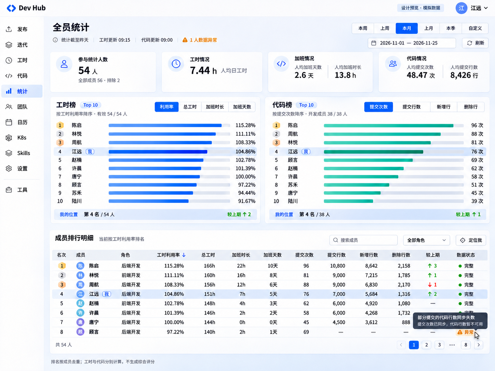

# Dev Hub 全员统计：开发与自验交接

日期：2026-11-26。主仓库：iw-mixes-web-platform；协作仓库：iw-mixes-server/iw-packaging-parent/iw-external。

设计状态：用户已确认按最新示例及后台每日汇总/预生成报表/旧快照保留设计进入新会话实施。代码状态：未实施。业务验收：未执行。

本会话只整理交接包；用户将在新会话粘贴[实施提示词](PROMPT.md)启动开发与本地自验。提交、推送、生产写入及发布未授权。本文件及附录是同一方案，不需要新会话重新确认已经确定的范围；普通实现细节自主决定。

## 1. 确认依据与目标

用户先明确“全团队”是同一CODING团队下全部DevHub团队成员，一起统计排行，并取消个人/团队维度。随后逐项调整两轮图片文案、卡片、榜单指标和13列明细。用户对性能方案最后回复：“可以，按照这种设计……生成提示词，我在新会话开始实施开发”。

本次完整目标：新增“统计”菜单，按最新图展示全员工时/代码排行榜和均值，统计查询快速读取后台生成的本地结果；首次、缓存过期、并发刷新均不能把原始数据全量计算压在HTTP请求上。

影响：Web页面/路由/类型/API/默认菜单偏好；后端iw-external的成员目录、统计派生存储、后台任务、报表查询及同步变更触发。小程序不涉及。没有需要重新询问的方向性阻断项；迁移细节、字段名、重试限额按附录和实际代码自主细化。

## 2. 页面与口径

图片已生成并打开检查；数据全为模拟，不进入产品、不证明真实查询或交互通过。无需重新生成可操作原型作为实施前置；直接实现正式页面并在真实浏览器自验。

用户明确的页面约束：

- 标题“全员统计”，没有“同一CODING团队/团队数/成员数”等介绍行，没有个人/团队范围选择。
- 四卡：参与统计人数；工时情况（值旁小字“人均日工时”）；加班情况（周期内人均加班天数/时长）；代码情况（周期内人均提交次数/提交行数）。图中删除的计算说明和周期辅文不要加回。
- 工时榜：利用率/总工时/加班时长/加班天数。代码榜：提交次数/提交行数/新增行/删除行；无活跃天数，无提交行数信息图标。
- 13列：名次、成员、角色、工时利用率、总工时、加班时长、加班天数、提交次数、提交行数、新增行数、删除行数、较上期、数据状态。无所属团队列；异常悬停说明。
- 双榜Top10、本人高亮与位置、完整分页表、姓名/角色过滤，保留现有DevHub浅色风格。

实施默认口径（已在讨论方案提出，按本交接执行，不声称用户逐个复述公式）：

- 同组织当前DevHub团队成员按userId并集；任一团队未忽略则参与，全部所属团队忽略才排除。不是本人加入团队并集，不额外导入组织内未进入DevHub者。
- 工时均值为完整且应出勤天数>0成员的总工时/应出勤人日合计；代码均值只针对当前开发成员，包含完整0值，分指标返回样本人数。
- 利用率/加班沿用原日历/请假/休息日规则；提交行数=新增+删除，非净增。merge排除；online.base.apijar.service只计次数、不计行数。
- 默认本月截至昨天，所有卡片/榜单/表格同截止日，区间最多366天；历史覆盖不足明确显示，不补0。
- 各指标独立排名，同值并列；过滤只过滤表格展示，保留全局名次。“较上期”为当前指标名次变化；不可比时不编造升降。
- 同CODING团队有效DevHub会话可读本功能全局汇总；不扩大其他团队原始事项、提交说明和原页面明细权限。不要新增成员详情抽屉等本图未要求能力。

## 3. 资料与源码基线

依次读取：本README → [查询公式与接口](QUERY_DESIGN.md) → [后台存储、刷新与迁移](STORAGE_AND_REFRESH.md)。性能架构以后台方案为准，不能恢复早期现场全量聚合方案。

核查日期2026-11-26，工作区/Users/wangfarui/workspaces/wfr/iw-mixes_ai。Web dev / 832d259fc607e7de660ff567b1e46d7bae36c517；后端main / c37fad6eb16e393968f93c24a593f66428c71e25。本轮检查后端干净，Web只有本交接包未跟踪。交接最终选定源码/契约/资产指纹见BASELINE.json（含未跟踪资料，不含密钥/依赖/产物）。基线不是全仓状态，也不覆盖数据库或运行进程，不能作为reset依据。

| 当前文件/模块 | 当前事实 | 本次复用/改动 |
| --- | --- | --- |
| Web src/views/zhaogang/ZhaogangWorkbench.vue、src/router/zhaogang.ts | DevHub菜单和壳层路由 | 增统计菜单/TabKey/路由/偏好 |
| Web src/types/zhaogang.ts、zhaogangCodeStats.ts及现有API | 工时/代码各自现行scope与状态 | 参考契约，新增统计API/types |
| 后端zhaogang/worklog/WorklogMirror、Repository、QueryService | 同成员唯一镜像、可见性/删除过滤、工时公式 | 共享批量读/计算，发布后登记统计脏区间 |
| 后端zhaogang/team/及团队/成员/profile Mapper | 现有面向成员团队范围 | 增组织内全员批量目录，不复用本人列表冒充全员 |
| 后端zhaogang/codestats/CodeIdentityResolver、CodeLinePolicy | 成员SELF唯一身份；apijar次数专属规则 | 全局批量身份归属与仓库口径复用 |
| 后端codestats/CodeScanWorker、CodeScanService、CodeContinuousSyncScheduler | 扫描与diff更新、后台版本和任务 | 成功发布后触发本地统计，维持原远端采集 |
| 后端scripts/iw-external-init.sql | 现有业务DDL | 增派生表初始化并另产幂等迁移脚本 |

后端包的完整前缀为iw-packaging-parent/iw-external/src/main/java/com/itwray/iw/external/。服务和数据库没有在本会话启动/迁移，账号登录态没有验证。

## 4. 接口、数据和异步行为

拟新增GET /external-service/api/zhaogang/statistics/report，组织取当前会话，不接收任意组织/团队/成员集合。响应绑定snapshotId，包含四卡、双榜Top10、本人位置、13列表格、覆盖人数、安全异常原因、两个同步时间、生成时间与刷新状态。具体字段见附录。

采用原始镜像→后台成员每日汇总→常用范围预生成报表→HTTP快照派生的三层结构。首次返回准备中，日汇总/report后台构建；60秒到期仍读适用旧快照，合并一次后台更新；新结果原子替换，失败保留旧合法结果。Redis丢失从持久report恢复。自定义区间从日汇总构建，不遍历原始提交。

强失效（权限/人口/身份撤销、明确删除、影响口径的角色/日历/请假变化）必须撤下不适用旧结果，发布前重校验。任务具备持久化、幂等、租约/fence、重启恢复、有限退避和漏事件补偿。后台重建有值变0/删除时必须撤销旧贡献。

刷新为本地异步统计更新，不触发CODING扫描。前端区分准备中、旧结果更新中、失败保留、完整0值和异常；取消或序列号处理迟到响应，账号变化清理；轮询不重复排队。

数据库采用派生日汇总、刷新任务和report快照存储，具体DDL实施前形成脚本并核对真实MySQL版本；不改原始事实来源。迁移执行/停止/恢复见后台方案。

## 5. 实施顺序

| 步骤 | 计划新增或修改位置 | 验证点 |
| --- | --- | --- |
| 1 | 后端statistics/领域契约、派生DDL/迁移，团队/工时/代码批量读门面 | 全员并集/权限/窄字段读取/公式同原规则 |
| 2 | statistics日汇总Repository/Builder、刷新Task/Worker/Scheduler | 跨团队SHA去重、零值/删除替换、任务恢复与原子发布 |
| 3 | 镜像/扫描/diff/身份/成员/日历等发布后脏标记与补偿 | 事务后触发、丢事件补偿、强失效可靠 |
| 4 | statistics ReportBuilder/Repository/Controller与可选热缓存 | 首次准备中、旧快照可用、60秒并发、防旧worker覆盖 |
| 5 | Web src/api/zhaogangStatistics.ts、src/types/zhaogangStatistics.ts、src/views/zhaogang/statistics/（新增）及壳层路由 | v3视觉、真实输入/排序/分页/切metric/tooltip/刷新异步状态 |
| 6 | 联合工作区对应产品/技术/运行文档及本仓验收目录 | 稳定契约同步，真实证据和限制完整 |

## 6. 自验环境、数据与用例

按[查询方案AC-01至AC-14](QUERY_DESIGN.md)及[后台方案AC-15至AC-23](STORAGE_AND_REFRESH.md)执行适用验收。全部当前结果为“未执行”，没有本轮编译、真实API或浏览器通过结论。测试与结果保存到主仓库docs/acceptance/devhub-statistics-<date>-<runId>/，逐项包含前提、步骤、预期、实际、版本、耗时和脱敏证据。

新会话提示词授权的本地范围：隔离MySQL测试schema内本功能DDL与独立夹具（唯一前缀DEVHUB_STATS_ACCEPT_<runId>），测试Clock/worker失败等受控注入只用于测试环境。若使用现有本地库，仅增维护本功能派生统计表，不修改真实成员、角色、原始工时或CODING数据。不用远端写接口构造用例；不得静默连接生产；只清理自己本轮标识的测试数据，报告派生表/回填数据与夹具残留。

真实DevHub会话优先复用当前浏览器已有登录，权限事实须验证；IW五角色验收账号不能默认替代CODING身份。缺登录态则继续隔离后端/页面非认证路径检查并明确真实链路缺口，必要时只索取必需的安全绑定；不伪造成功或要求用户回传完整PAT。

必须完成Web type-check/build和实际浏览器页面检查；后端Java17按目标模块编译/关键行为测试，MySQL去重/锁/事务/迁移以真实本地测试库验证，mock/H2不替代。分别报告编译、自动测试、真实API和浏览器结果。

性能覆盖首次HTTP/后台构建、热读、60秒过期并发、刷新失败、Redis重启/worker恢复、自定义90/366天，记录真实样本量、SQL数、耗时和关键EXPLAIN；不预先承诺固定毫秒数。HTTP不得CODING读取或原始记录全量回扫。

Maven固定路径/usr/local/maven/apache-maven-3.8.6/bin/mvn，显式-Dmaven.repo.local=/usr/local/maven/repository；执行前检查Maven/Java选项及.mvn冲突，用显式-s避开用户级settings，核查global settings；仓库不可写走相同路径权限流程。服务启停只用iw-mixes-server/scripts/local-backend.sh，先读帮助/状态并确认当前运行加载本次代码。

## 7. 授权与完成条件

用户要求新会话实施：发送PROMPT.md后可在该会话进行Web/后端开发、上述本地验证和必要受控派生数据迁移；本会话只交接。常规技术选择/已确认需求不再反复审批；实质契约冲突、超范围数据写入或权限阻断才询问，期间继续独立工作。

没有授权Git提交/推送、创建新聊天、生产数据或生产DDL执行、UAT/PRD构建及部署。生产迁移仅产出脚本和操作说明。

完成条件为功能实现和适用验收有真实证据，范围内问题自主修复复验，源码/版本/DB迁移和清理记录可复核。若必需环境受阻，准确报告“实施完成，验收部分完成/未完成”与缺口，不能把效果图、编译或历史会话结果当整体通过。

文档与选定基线检查只证明资料一致性，不证明业务完成。静态示例图是视觉依据，未另做动态原型；新会话直接正式实施后做真实交互验证。

## 8. 新会话提示词

完整可复制提示词见[PROMPT.md](PROMPT.md)。用户自行创建新会话，本会话不代为创建或发送。
